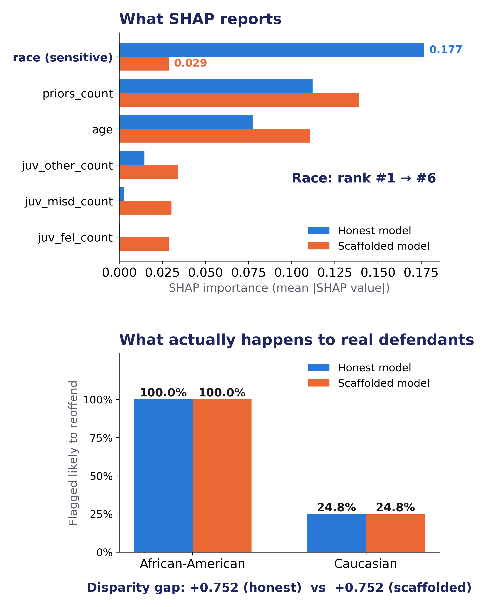

# Fooling SHAP: A Scaffolding Attack on COMPAS Risk Explanations

A classifier can score real defendants in a racially biased way while showing
an auditor a clean, race-blind explanation. This project builds that attack on
the ProPublica COMPAS data and measures the gap between what the audit sees
and what actually happens.

## Result

| Measure | Honest model (audited directly) | Scaffolded system |
|---|---|---|
| Race's SHAP rank (of 6 features) | **#1** (0.177) | **#6** (0.029), −83.7% |
| SHAP queries caught by the detector | n/a | 99.95% (310,000 of 310,150 rows; see limitations) |
| Real disparity gap (AA − Caucasian flagged high-risk) | +0.752 | +0.752 (unchanged) |
| Disparity gap the audit sees | +0.752 | +0.242 (≈3× understated) |

Real defendants are scored in batches, so they always reach the biased
model: the real gap is identical with and without the scaffold. I want to highlight: the attack changes the explanation, not the decisions.



## How it works

- **BiasedModel** – random forest (200 trees, depth 6) plus an additive race
  penalty (`bias_strength = 0.35`) so the bias is known and controllable.
- **InnocuousModel** – same forest trained on the 5 non-race features only.
- **Lookout** – `shap.KernelExplainer`
  reuses a ~100-row background sample for every coalition, so its batches are
  full of exact duplicate rows. Batches of ≤25 rows are always treated as real;
  larger batches with <50% unique rows are flagged as SHAP probing.
- The scaffold is a **switch, not a blend**: each batch goes to exactly one model.

Diagrams: [`figures/pipeline_diagram.png`](figures/pipeline_diagram.png),
[`figures/batch_fingerprint_diagram.png`](figures/batch_fingerprint_diagram.png).

## Run it

Python 3.10+ (developed on 3.11).

```bash
python -m venv venv && source venv/bin/activate     # Windows: venv\Scripts\activate
pip install -r requirements.txt

python src/data_utils.py       # sanity check: 3,694 train / 1,584 test rows
python src/run_experiment.py   # the attack + SHAP audit -> results/results.json   (needs shap)
python src/decoy_audit.py      # what the audit sees (decoy) -> results/decoy_audit.json
cd figures && for f in make_*.py; do python "$f"; done   # regenerate poster figures
```

Paths are resolved relative to the files, so scripts can be run from any
directory. `run_experiment.py` can take several minutes (KernelExplainer on 50 test
rows, twice).

## Data

`data/compas-scores-two-years.csv` is ProPublica's COMPAS file from
[propublica/compas-analysis](https://github.com/propublica/compas-analysis)
(Broward County, FL; Angwin et al., 2016, *Machine Bias*), included so the
project runs offline. Check ProPublica's repo for its terms of use.
Standard ProPublica filtering is applied, then only African-American and
Caucasian defendants are kept: **5,278 rows**, 6 features (`age`,
`priors_count`, `juv_fel_count`, `juv_misd_count`, `juv_other_count`,
`race_binary`), label `two_year_recid`. 70/30 stratified split, `random_state=0`.

## Repository layout

```
src/run_experiment.py        end-to-end attack + SHAP audit
src/decoy_audit.py           audit-vs-reality numbers (no SHAP needed)
src/models.py                BiasedModel, InnocuousModel
src/ood_detector_batch.py    the Lookout (final detector)
src/scaffold.py              ScaffoldedClassifier (the switch)
src/data_utils.py            loading, cleaning, split
src/plot_results.py          original combined results plot
src/legacy/                  first-attempt per-row trained detector (not used)
figures/                     scripts + PNGs used on the poster
results/                     results.json, decoy_audit.json
data/                        COMPAS CSV
```

## Design decisions

- **Batch-level detector instead of per-row.** My first detector classified
  single rows (like Slack et al.) and plateaued near 54% accuracy. Here, I realizes one row carries little signal. What was nice is that SHAP's batches are distinctive (heavy duplication), so the final detector looks at the batch.
- **Injected bias.** The race penalty is added by hand so the ground truth is
  known. The experiment therefore tests the *audit*, not COMPAS itself.
- **Real data for the decoy.** The InnocuousModel uses the actual non-race
  COMPAS features instead of synthetic uncorrelated ones.
- **Realistic deployment.** Real defendants are scored in chunks of 10, which
  is both realistic and keeps the duplicate-row rule from misfiring on them.
- **Audit-vs-reality gap** (`decoy_audit.py`) is reported explicitly, as the
  comparison that shows how much the audit understates.

## Known limitations

- **Brittle by design.** The detector exploits one fact about KernelExplainer
  (background reuse). An auditor who queries in batches of ≤25 rows would likely
  defeat it.
- **The honest model flags every African-American defendant (100%)**: the
  0.35 penalty saturates the model. A lower `bias_strength` gives a more
  moderate picture (an earlier run with a lower value gave 99.0% / gap +0.741).
- **Race is last .** Race (0.0288) is essentially tied with `juv_fel_count`
  (0.0288), so "rank #6" depends on a tie at four decimals. A fairer description
  is "tied for last, ~84% lower than the honest model".
- **The 150 uncaught rows are not detector mistakes.** Every one of the 310,000
  coalition rows SHAP generated (50 test rows x 62 coalitions x 100 background rows)
  was caught. The uncaught 150 are KernelExplainer's two anchor calls: the 50
  explained instances and the 100 background rows, each batch fully unique, so the
  Lookout correctly treats them as real and the BiasedModel answers. These
  anchors plausibly explain why race is not exactly zero (SHAP forces its values
  to sum to the gap between the anchors), but I have not tested that explanation.
- **SHAP only.** LIME and other explainers were not attacked. The Volkswagen and
  Huawei cases cited on the poster are analogies; I found no documented case of
  a deployed model fooling SHAP or LIME.
- **Single run, single seed**, no confidence intervals. Numbers reproduced
  exactly on a second machine (Windows, Python 3.12, shap 0.52.0,
  scikit-learn 1.9.1, pandas 3.0.6, numpy 2.5.3), but other `shap` versions
  were not tested.

## Ideas for future work

Adaptive auditor (small-batch queries); a model that *learned* its bias instead
of having it injected; LIME and other post-hoc explainers.

## References

- Slack, Hilgard, Jia, Singh, Lakkaraju (2019). *Fooling LIME and SHAP.* AIES. https://arxiv.org/abs/1911.02508 · code: https://github.com/dylan-slack/Fooling-LIME-SHAP
- Angwin, Larson, Mattu, Kirchner (2016). *Machine Bias.* ProPublica.
- U.S. Department of Justice (2017). *Volkswagen AG Agrees to Plead Guilty and Pay $4.3 Billion in Criminal and Civil Penalties.* justice.gov
- Engadget (2018). *Huawei was caught cheating on benchmarks.* engadget.com

Thanks to Professor Brinnae Bent for guidance.
